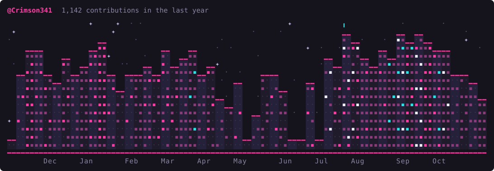

# Crimson

Building things. Breaking things. Figuring it out.

I write TypeScript and Rust, plus some C# and Swift when a project calls for it.

### Things I've built

- **[vigil](https://github.com/Crimson341/vigil)**: point it at a project and it tells you which dependencies have known vulnerabilities and which version fixes them. Reads npm, pnpm, yarn and bun lockfiles. Rust.
- **[qexec](https://github.com/Crimson341/qexec)**: automates quests in AQWorlds. It picks its own gear and fights on its own. C#, built on Skua.
- **[cleanme](https://github.com/Crimson341/cleanme)**: a native macOS cleaner. Clutter, browser data, duplicates, startup items. Swift and SwiftUI.
- **[realmsunbound](https://github.com/Crimson341/realmsunbound)**: build fantasy worlds, then let other people explore them. [Live](https://realmsunbound.vercel.app).
- **[spark-rabbit](https://github.com/Crimson341/spark-rabbit)**: one-page sites for local businesses. [Live](https://crimson341.github.io/spark-rabbit/).

### Open source

- **[OpenFront](https://github.com/openfrontio/OpenFrontIO)**: grouped inbound missile warnings by sender and bomb type. [#6373](https://github.com/openfrontio/OpenFrontIO/pull/6373), merged.
- **[plasma-ui](https://github.com/CruxGarden/plasma-ui)**: added button, switch, slider, tabs and accordion components. [#7](https://github.com/CruxGarden/plasma-ui/pull/7), merged.

<!-- skyline -->

<!-- pacman -->
<picture>
    <source media="(prefers-color-scheme: dark)" srcset="https://raw.githubusercontent.com/Crimson341/Crimson341/output/pacman-contribution-graph-dark.svg">
    <source media="(prefers-color-scheme: light)" srcset="https://raw.githubusercontent.com/Crimson341/Crimson341/output/pacman-contribution-graph.svg">
    
</picture>
